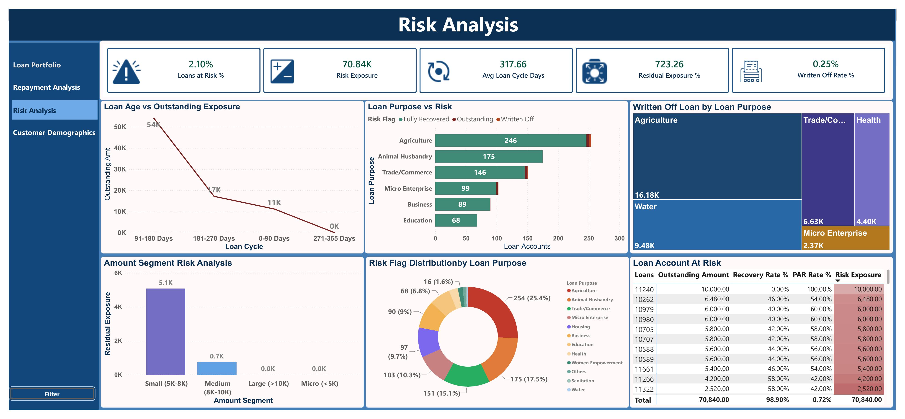
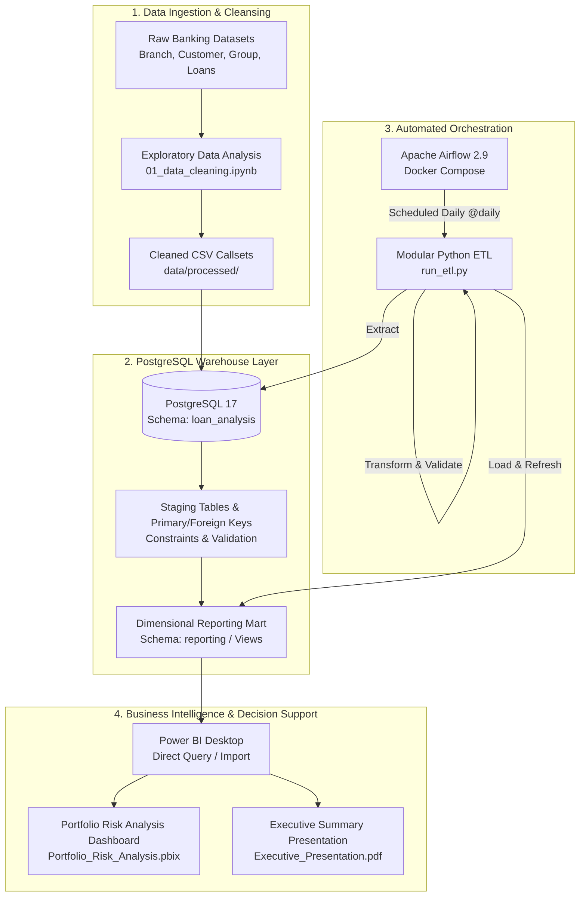
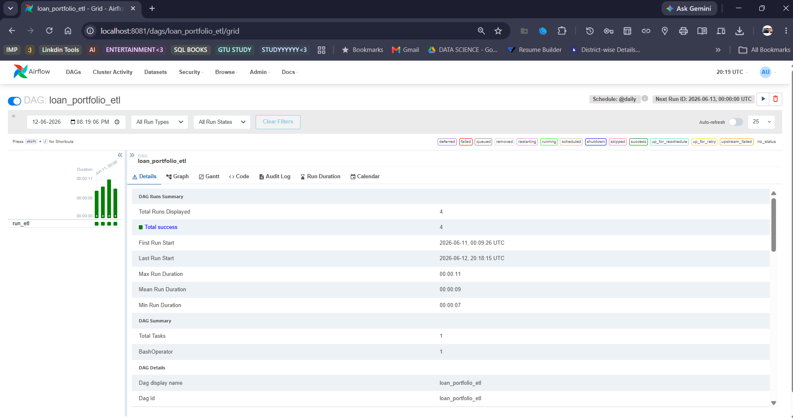
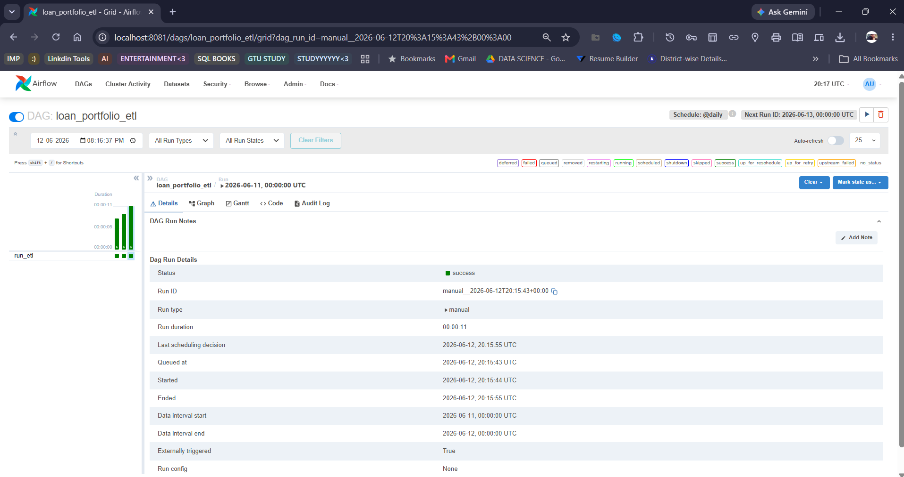
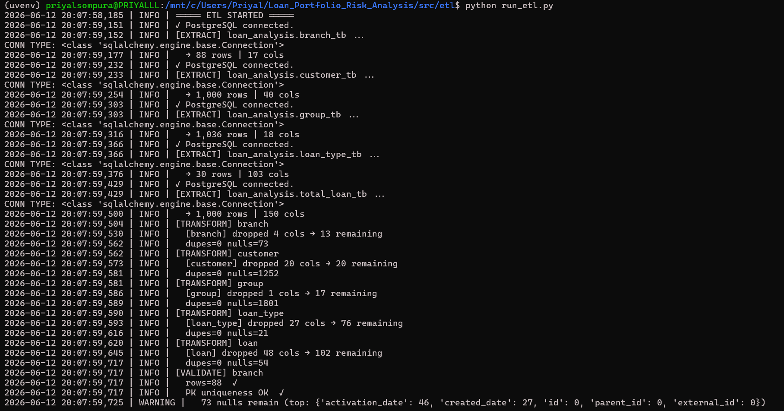
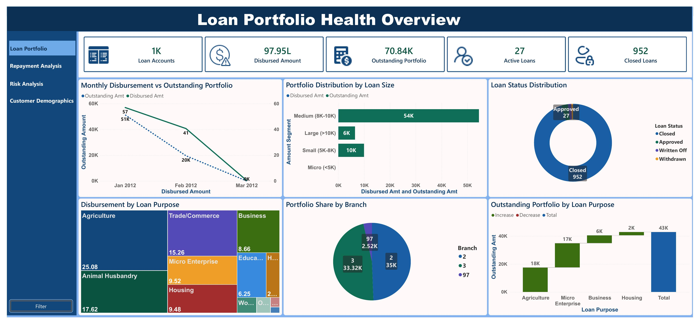
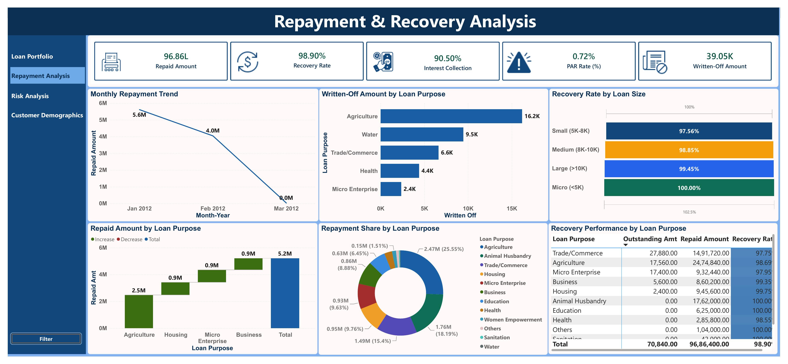
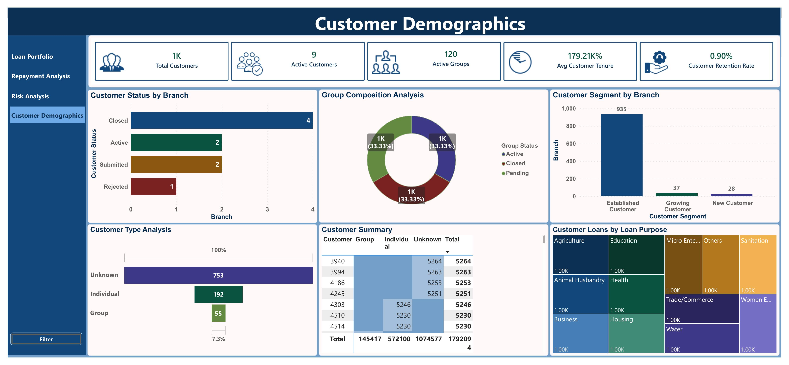

# 🏦 Loan Portfolio Risk Analysis & Analytics Engineering Pipeline


An enterprise-grade, end-to-end **Data Engineering, Data Modeling, and Business Intelligence** platform built to monitor microfinance and commercial banking loan portfolios, identify credit risk exposure, automate daily ETL workflows with **Apache Airflow in Docker**, and deliver interactive executive dashboards in **Power BI**.

---

## 📸 Executive Showcase: Risk Analysis Dashboard

The primary deliverable of this project is the **Portfolio Risk Analysis Dashboard** (`powerbi/Portfolio_Risk_Analysis.pbix`), designed specifically for Credit Risk Committees and Chief Risk Officers (CROs) to detect delinquency trends and quantify capital exposure.



---

## 📌 Executive Summary & Business Problem

In lending and microfinance, institutional stability relies not merely on origination volume, but on **credit risk management, repayment velocity, and default mitigation**. 

This project solves critical operational and analytical bottlenecks:
1. **Siloed & Inconsistent Data:** Raw transactional tables suffered from missing values, untyped date fields, and lack of referential constraints.
2. **Manual Reporting Overhead:** Daily collection and delinquency reports were manually computed, delaying default intervention.
3. **Lack of Early Warning Metrics:** Risk teams lacked real-time visibility into **Portfolio at Risk (PAR)**, **Non-Performing Assets (NPA)**, and **Residual Capital Exposure**.

### 🎯 Key Outcomes Delivered:
- **1,000 Loan Accounts Analyzed:** Covering **₹97.95L** in cumulative disbursements.
- **Automated Daily Data Pipeline:** Zero-touch ingestion and validation via containerized **Apache Airflow**.
- **98.90% Portfolio Recovery Rate:** Realized through granular repayment tracking across 88 branches and 120 borrowing groups.
- **0.72% PAR Rate / 2.10% Loans at Risk:** Quantified across 30, 60, and 90-day aging delinquency buckets.

---

## 🏗️ End-to-End Solution Architecture



---

## 🚀 Pipeline Automation: Apache Airflow & Docker

The ETL workflow is orchestrated using **Apache Airflow 2.9.3** running in isolated Docker containers (`docker-compose.yml`), eliminating manual intervention and ensuring predictable execution.

### ✅ Airflow DAG Run Verification
The DAG (`loan_portfolio_etl`) runs on a daily cadence (`@daily`), executing the full pipeline sequence with automated failure alerting and retry logic.



### 📊 Airflow Pipeline Task Graph


```bash
# Spin up the Airflow container stack
cd src/airflow_dag
cp .env.example .env
docker-compose up -d
```

---

## ⚙️ Modular Python ETL Pipeline

The ETL architecture (`src/etl/`) is decoupled into clean, single-responsibility modules:

```text
src/etl/
├── extract/extract.py         # Connects via SQLAlchemy connection pooling to extract raw tables
├── transform/transform.py     # Implements business rules, type casting & null imputation
├── load/load.py               # Executes transactional database loading & data integrity assertions
├── load/constraints.py        # Applies and manages PK/FK referential integrity constraints
├── load/validate.py           # Pre-load and post-load schema consistency validation
├── database.py                # Database engine factory with connection reuse
├── config.py                  # Table mappings, schemas & environment configurations
└── run_etl.py                 # Master execution orchestrator called by Airflow
```

### 📋 ETL Execution Proof & Integrity Logging


---

## 🗄️ Relational Modeling & Star-Schema Data Mart

The PostgreSQL 17 database is modeled into two operational tiers:
1. **Normalized OLTP Layer (`loan_analysis` schema):** Contains full historical loan logs, customer demographics, and branch details.
2. **Dimensional Data Mart (`reporting` schema):** Optimized analytical views providing star-schema relationships for Power BI.

```
       dim_branch ────────┐
                          ▼
      dim_customer ──► fact_loan_portfolio ◄── dim_loan_product
                          ▲
      dim_loan_group ─────┘
```

### Key Analytical Views:
- **`dim_branch`:** Branch geography, branch manager hierarchy, active loan portfolio count.
- **`dim_customer`:** Borrower profile, age band, gender distribution, KYC tier, customer tenure.
- **`dim_loan_product`:** Loan category, interest rate structure, repayment cycle, tenure frequency.
- **`fact_loan_portfolio`:** 100+ transactional fields tracking disbursed principal, interest accrued, penalties, write-offs, and outstanding balances.

---

## 📊 Comprehensive Power BI Dashboards

The reporting suite includes multiple dedicated dashboards tracking each critical phase of the loan lifecycle:

### 1. Risk Analysis Dashboard (Primary Showcase)
Focuses on default probability, aging delinquency buckets, and collateral exposure.


### 2. Loan Portfolio Health Dashboard
Provides a holistic overview of capital deployed, active borrowers, and total outstanding exposure.


### 3. Repayment & Recovery Analysis Dashboard
Tracks collection efficiency, interest realization, and principal recovery rates across loan products.


### 4. Customer Demographics & Cohort Analysis
Analyzes borrower retention, borrowing group dynamics, and risk segmentation by demographics.


---

## 📈 Key Risk Metrics & DAX Formulas

| KPI Name | Business Definition | DAX Formula |
| :--- | :--- | :--- |
| **Portfolio at Risk (PAR)** | Proportion of the portfolio with payments overdue (>30 days). | `DIVIDE(CALCULATE(SUM(fact[principal_outstanding]), fact[is_overdue] = TRUE), SUM(fact[principal_outstanding]), 0)` |
| **NPA Rate** | Ratio of non-performing loans to total gross loan book. | `DIVIDE(CALCULATE(COUNTROWS(fact), fact[is_npa] = TRUE), COUNTROWS(fact), 0)` |
| **Recovery Rate** | Percentage of cumulative disbursed capital successfully recovered. | `DIVIDE(SUM(fact[principal_repaid_derived]), SUM(fact[principal_disbursed_derived]), 0)` |
| **Interest Realization** | Ratio of collected interest against total interest charged. | `DIVIDE(SUM(fact[interest_repaid_derived]), SUM(fact[interest_charged_derived]), 0)` |
| **Residual Exposure** | Net uncollateralized exposure remaining on active accounts. | `SUM(fact[principal_outstanding_derived]) - SUM(fact[collateral_value])` |

---

## 📂 Repository Organization

```text
loan_portfolio_risk_analysis/
│
├── .gitignore                                 # Git rules ignoring venvs, logs & secrets
├── README.md                                  # ⭐ Project master documentation
├── requirements.txt                           # Full Python dependencies
│
├── data/
│   ├── raw/                                   # Original source CSV datasets
│   │   ├── branch_cleaned.csv
│   │   ├── customer_cleaned.csv
│   │   ├── group_details_cleaned.csv
│   │   ├── loan_type_cleaned.csv
│   │   └── total_loan_cleaned.csv
│   └── processed/                             # Validated, uncorrupted staging datasets
│       ├── cleaned_branch_data.csv
│       ├── cleaned_customer_data.csv
│       ├── cleaned_group_data.csv
│       ├── cleaned_loan_data.csv             # Uncorrupted integer IDs
│       └── cleaned_loan_type_data.csv
│
├── docs/
│   └── Executive_Presentation.pdf             # 📑 Executive slide presentation deck
│
├── powerbi/
│   ├── Portfolio_Risk_Analysis.pbix           # ⭐ Primary Showcase Power BI Report
│   ├── themes/
│   │   └── Theme.json                         # Custom enterprise color palette
│   └── docs/                                  # Walkthrough guides & speech scripts
│       ├── Project_Walkthrough_Speech.md
│       ├── PowerBI_Loan_Dashboard_Guide.docx
│       ├── PowerBI_PostgreSQL_Connection_Setup.docx
│       ├── PowerBI_Report_Documentation.docx
│       └── stepsofloading.docx
│
└── src/
    ├── airflow_dag/                           # 🚀 Airflow containerization & DAG
    │   ├── dags/dag.py
    │   ├── docker-compose.yml
    │   ├── requirements.txt
    │   ├── commands.txt
    │   ├── .env.example
    │   └── README.md
    │
    ├── etl/                                   # ⚙️ Modular Python ETL Pipeline
    │   ├── extract/extract.py
    │   ├── transform/transform.py
    │   ├── load/load.py
    │   ├── load/constraints.py
    │   ├── load/validate.py
    │   ├── run_etl.py
    │   ├── config.py
    │   ├── database.py
    │   └── requirements.txt
    │
    ├── notebooks/                             # 🔬 EDA & Data Cleaning Proof
    │   ├── 01_data_cleaning.ipynb
    │   ├── check.py
    │   └── config/
    │       ├── config.env.example
    │       ├── database.py
    │       └── settings.py
    │
    ├── sql/                                   # 🗄️ Relational DDL & Analytical Views
    │   ├── queries/
    │   │   ├── 01_create_schema_tables.sql
    │   │   ├── 02_load_data.sql
    │   │   ├── 03_foreign_keys.sql
    │   │   ├── 04_data_validation.sql
    │   │   └── 05_sql_scripts.sql
    │   └── views/
    │       └── 01_create_views.sql
    │
    └── images/                                # 🖼️ Screenshots & verification artifacts
        ├── dashboard_risk_analysis.jpeg
        ├── dashboard_portfolio_health.jpeg
        ├── dashboard_repayment_recovery.jpeg
        ├── dashboard_customer_demographics.jpeg
        ├── airflow_suc.png
        ├── airflow_lay.png
        ├── airflow_pip.png
        ├── airflow_terminal.png
        ├── etl_1.png
        ├── etl_2.png
        └── etl_3.png
```

---

## 🛠️ Step-by-Step Setup Guide

### 1. Clone Repository & Setup Virtual Environment
```bash
git clone https://github.com/<your-username>/loan_portfolio_risk_analysis.git
cd loan_portfolio_risk_analysis

# Create and activate environment
python -m venv venv
.\venv\Scripts\activate      # Windows
source venv/bin/activate     # macOS / Linux

# Install dependencies
pip install -r requirements.txt
```

### 2. Initialize PostgreSQL Database
1. Launch PostgreSQL and create a database named `loan_portfolio_db`.
2. Execute the scripts in `src/sql/queries/`:
   ```sql
   \i src/sql/queries/01_create_schema_tables.sql
   \i src/sql/queries/02_load_data.sql
   \i src/sql/queries/03_foreign_keys.sql
   \i src/sql/queries/04_data_validation.sql
   \i src/sql/views/01_create_views.sql
   ```

### 3. Run the Automated ETL Pipeline
```bash
python src/etl/run_etl.py
```

### 4. Launch Airflow with Docker
```bash
cd src/airflow_dag
cp .env.example .env
docker-compose up -d
```
Access the Airflow UI at `http://localhost:8080` (Username: `airflow` | Password: `airflow`).

### 5. Open the Power BI Dashboard
Open `powerbi/Portfolio_Risk_Analysis.pbix` in Microsoft Power BI Desktop.

---

## 📑 Executive Presentation
For a presentation-ready project walkthrough, refer to the included executive slide deck:
👉 **[Download Executive Presentation (PDF)](docs/Executive_Presentation.pdf)**

---

## 👤 Author & Contact
- **Author:** Priyal Sompura
- **Domain:** Data Engineering · Financial Risk Analytics · Business Intelligence
- **LinkedIn:** [linkedin.com/in/priyal-sompura](https://www.linkedin.com)

